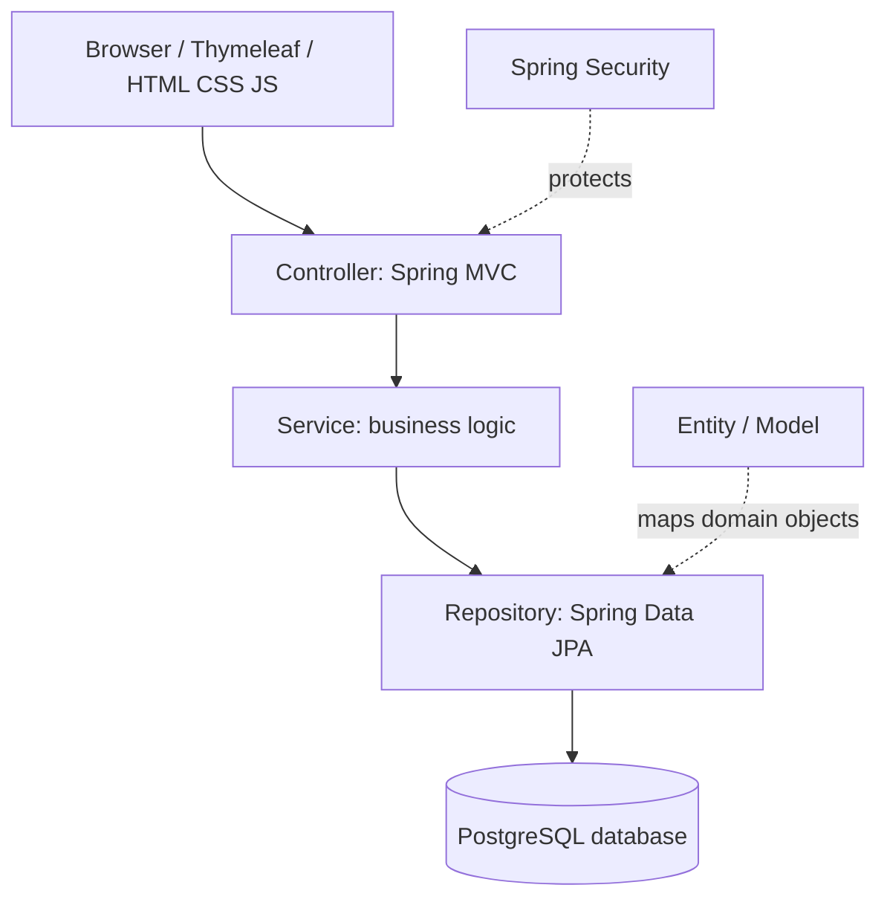
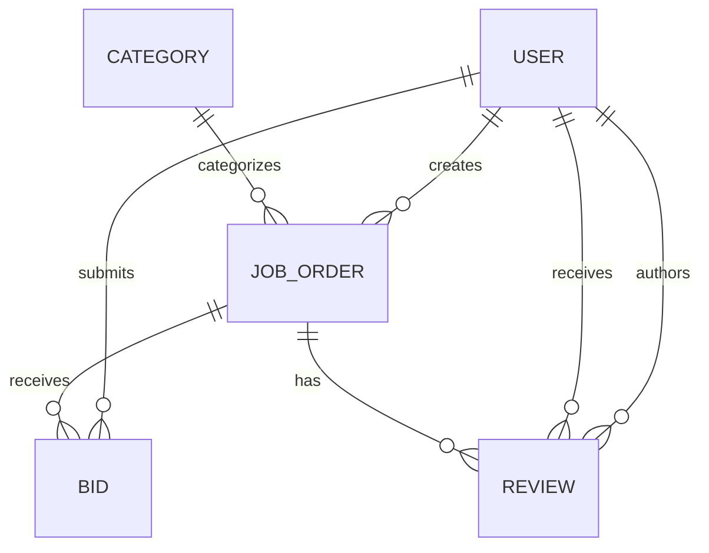

# Spring Boot application architecture

## Responsibilities

- **Frontend:** Displays pages and sends HTML form requests.
- **Controller:** Receives HTTP requests and returns Thymeleaf views or redirects.
- **Service:** Applies business logic such as ensuring a job has at most one accepted bid.
- **Repository:** Queries and persists data using Spring Data JPA / Hibernate.
- **Entity / Model:** Represents application data and relational mappings.
- **Database:** PostgreSQL stores registered users, job posts, bids, and reviews.
- **Security:** Spring Security protects pages and role-specific actions.

## Entity relationships

Example domain model:

- **User:** id, fullName, email, passwordHash, role.
- **Category:** id, name.
- **JobOrder:** id, clientId, categoryId, title, description, budget, deadline, status.
- **Bid:** id, orderId, freelancerId, proposedPrice, proposedDeadline, message, status.
- **Review:** id, orderId, authorId, recipientId, rating, comment.

## Data flow example

1. A freelancer submits a bid from a Thymeleaf form.
2. `BidController` receives the POST request and validates the input.
3. `BidService` checks that the user is authorized and that the job accepts bids.
4. `BidRepository` saves the bid entity.
5. PostgreSQL persists it and the controller redirects to the dashboard.

The architecture diagram is a planned design; Spring Boot source code is not implemented during Lab 7.
